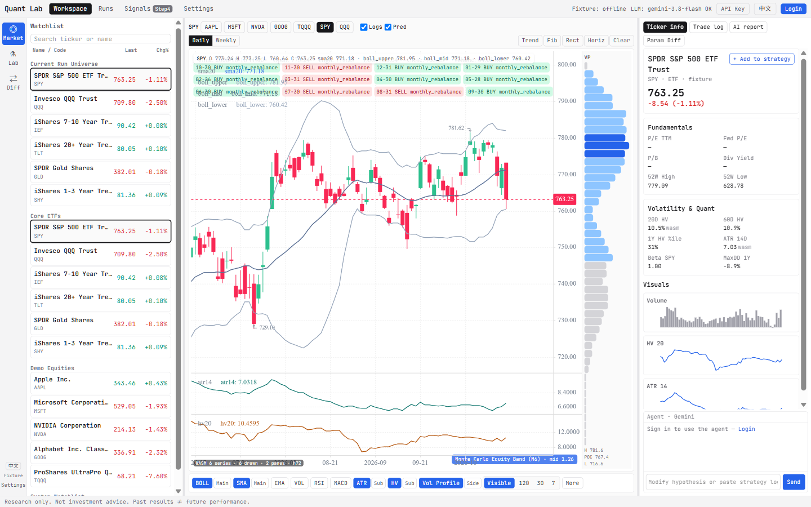
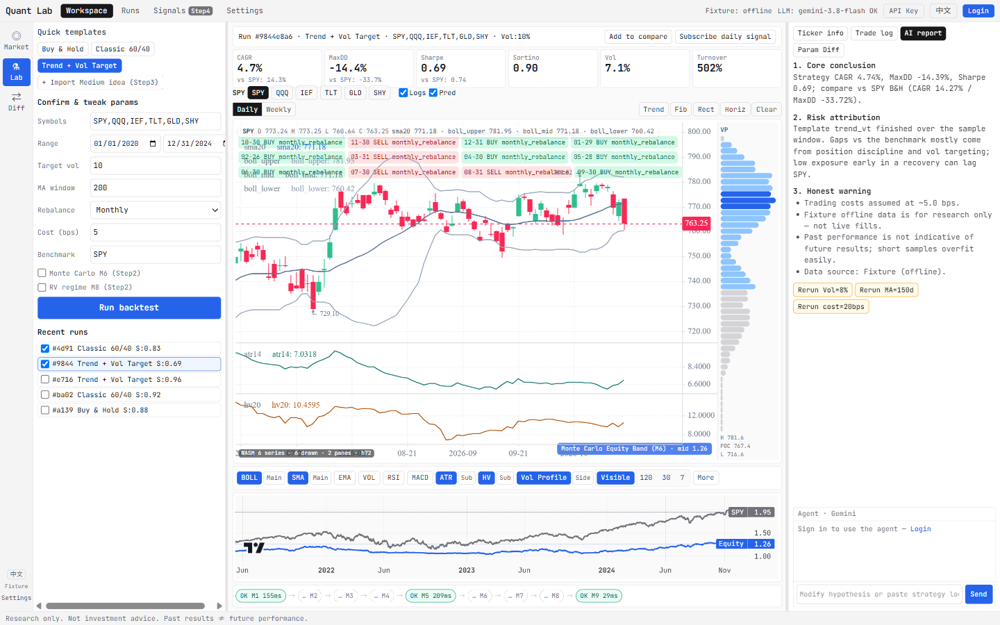
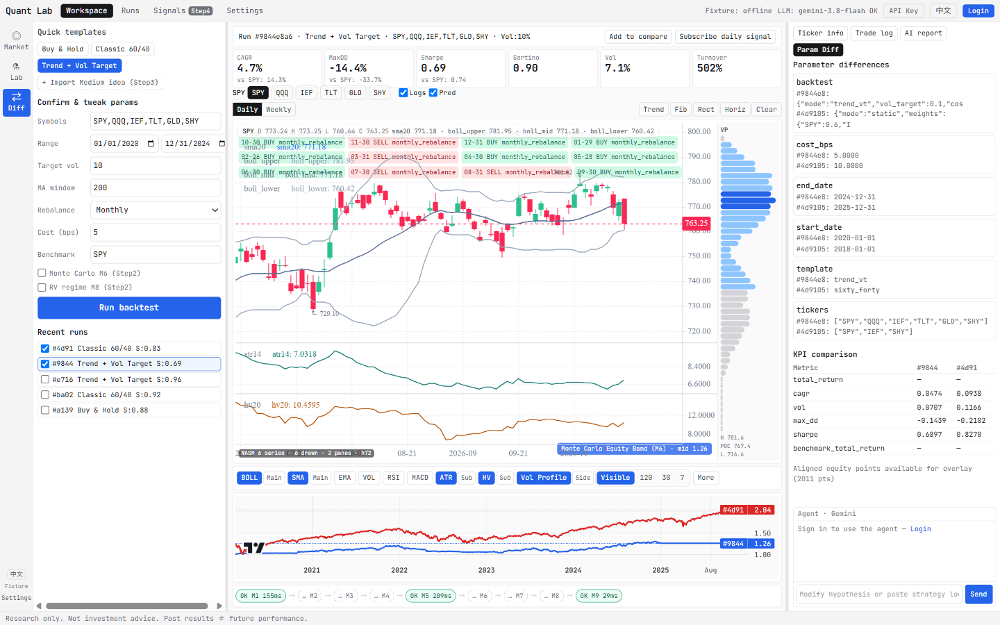

# Quant Lab

Research workbench for **personal researchers** and **quant beginners**: form a hypothesis, backtest it, read an honest narrative, change one assumption and compare — with market-style charts (indicators, drawings, watchlist) to scout tickers first.

Not a broker or live trading terminal. Monte Carlo stress paths and optional RV/ML steps are research tools, not trade execution.

## Screenshots (Step 2)

Full set and captions: [`docs/screenshots/step2/`](./docs/screenshots/step2/).

| Market | Lab | Diff |
| --- | --- | --- |
|  |  |  |

## Repository layout

| Path | Role |
| --- | --- |
| `apps/web` | React + Vite workspace UI |
| `apps/api` | FastAPI |
| `apps/agent` | Pi / LLM host |
| `apps/worker` | Job runner |
| `packages/quant` | M1–M9 quant modules |
| `packages/contracts` | OpenAPI |
| `crates/quant-wasm` | Browser WASM indicators |
| `docs/` | PRD, specs, progress, screenshots |
| `design/` | IA and design tokens |
| `legacy/` | Archived Streamlit / RV pipeline assets — [`legacy/ASSETS.md`](./legacy/ASSETS.md) |

## Quick start

```bash
cp .env.example .env
export UV_PROJECT_ENVIRONMENT=.venv-lab   # optional if .venv is locked
make sync
make up-db    # optional; SQLite works without Docker
make api      # :8080
make web      # :5173  (proxies /api → api)
# optional: nvm use 22 && make agent   # :8081
```

Details: [`docs/DEVELOPMENT.md`](./docs/DEVELOPMENT.md). Models: [`docs/MODELS.md`](./docs/MODELS.md).

## Documentation

| Doc | |
| --- | --- |
| [Docs index](./docs/README.md) | All product / eng docs |
| [PRD](./docs/PRD.md) | Product requirements |
| [Step2 progress](./docs/reports/05-step2-progress.md) | Current workspace status |
| [Legacy assets](./legacy/ASSETS.md) | Old RV pipeline archive index |

## License

See [LICENSE](./LICENSE).
