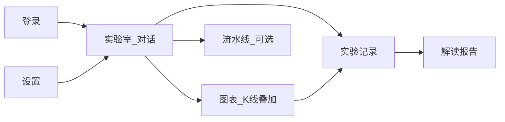

# 产品需求文档（PRD）· Quant Lab

| 项 | 内容 |
| --- | --- |
| 状态 | 已定稿（产品视角） |
| 受众 | 个人研究者、量化入门者 |
| UI 语言 | 中文优先；标的代码保留市场惯例（如 `SPY`） |
| 关联技术计划 | [Quant Lab Refactor](file:///home/shilong/.cursor/plans/quant_lab_refactor_12a23f18.plan.md)（架构 / API / Cloud Run；本 PRD 不重复） |
| 导航定稿 | [design/ia/navigation.md](../design/ia/navigation.md) |
| LLM | 主模型 `gemini-3.8-flash`；lite `gemini-3.1-flash-lite`（测试 + context compact）— [MODELS.md](./MODELS.md) |

---

## 1. 产品一句话

**Quant Lab** 是给个人研究者和量化刚入门者用的「对话式研究台」：用自然语言提出想法，由 LLM 帮你拆成可运行的数据/指标/组合/回测步骤，跑完后用图表和人话解读结果，并可一键改假设再跑。

## 2. 目标用户与场景

### 2.1 人格

| 人格 | 诉求 | 痛点 |
| --- | --- | --- |
| **个人研究者** | 快速验证假设、留存实验轨迹、对比多次 run | 工具链散落（Excel/Notebook/券商），复现成本高 |
| **量化入门者** | 搞懂「想法 → 规则 → 回测 → 指标」在说什么 | 术语多、怕写代码、看不懂回撤/夏普/过拟合 |

### 2.2 核心工作（Jobs-to-be-done）

1. **探索**：把模糊想法变成可测的策略假设（标的、规则、再平衡、约束）。
2. **验证**：在历史数据上跑回测（及可选压力/蒙特卡洛），看到权益与交易痕迹。
3. **解读**：用通俗语言解释「好在哪、差在哪、可能哪里过拟合」。
4. **迭代**：改一两个假设（换资产、加趋势过滤、降波动目标）再对比。

### 2.3 非目标用户（v1）

- 实盘下单/券商接单系统用户
- 高频/日内 tick 交易者
- 需要多团队协作与复杂权限的机构台

## 3. 产品原则

1. **对话优先，面板辅助**：默认从「实验室对话」进入；高级用户可切到流水线/参数面板。
2. **每一步可看见、可重跑**：不黑箱；Agent 调用的每步 Job 有状态、输入输出、可单独重跑。
3. **图表讲故事**：K 线 + 买卖/再平衡点 + 权益/回撤联动，少堆无关联卡片。
4. **入门友好的诚实**：结果区必须提示局限（样本外、成本、过拟合风险），禁止「稳赚」话术。
5. **本地可玩、云上可部署**：开发用本地 Postgres；生产 Cloud Run（细节见技术计划）。

## 4. 产品长什么样（信息架构）

中文 UI 优先；标的代码保持市场惯例（如 `SPY`）。

| 区域 | 用户感知 | 主要能力 |
| --- | --- | --- |
| **实验室** | 主界面：左对话 / 右结果摘要 | 自然语言提想法；看 Agent 步骤；一键「跑回测」 |
| **图表** | 研究画布 | K2：多周期、均线等、买卖点、再平衡、regime 着色、权益联动 |
| **实验记录** | 历史 run 列表与对比 | 按时间/标签筛选；并排对比关键指标 |
| **流水线** | 进阶视图 | 可视化 M1–M9 步骤；拖拽或勾选组装（Agent 也会写同一套） |
| **设置** | 账号、邀请、LLM Key（可自带）、默认标的池 | 轻量多用户 |

视觉方向：偏 **研究工作台 / Data Dashboard**——克制、信息密度适中、单一强调色；避免通用「紫色 SaaS 模板」感。品牌名在首屏有存在感，但第一屏不堆指标条。

站点地图与命名约定见 [design/ia/navigation.md](../design/ia/navigation.md)。

## 5. 功能需求

优先级：P0 必须有闭环；P1 明显增强；P2 可后置。

### 5.1 账户与工作区（P0）

- 邀请码注册 + 用户名密码登录
- 个人实验数据隔离（看不到他人 run）
- 可选：用户自备 LLM API Key；否则用服务端配置（需在 UI 标明）

### 5.2 实验室对话 + Agent（P0）

用户可说例如：

- 「用 SPY/QQQ/IEF/TLT/GLD，200 日趋势过滤 + 波动目标 10%，月度再平衡，回测近 3 年」
- 「把现金换成 SHY，成本按 5bp，再跑一次并对比」
- 「用大白话解释这次最大回撤发生在什么阶段」

系统行为：

- 把意图拆成流水线步骤（数据 → 指标 → 优化/权重 → 回测 → 报告）
- 每步展示进度（SSE）；失败可重试单步
- 跑完给出：关键数字摘要 + 链到图表/完整报告
- Agent **不能**静默改历史数据或跳过成本假设；参数变更需在对话或面板可见

### 5.3 数据与标的（P0）

- v1 默认宇宙：**美股流动性 ETF + 常见指数类标的**（与 DD-Guard 研究一致的一类资产）；支持用户输入 ticker 拉取
- 展示数据区间、复权说明、缺失/停牌的简短提示
- 缓存：同一标的同区间不重复盲拉（用户无感）

### 5.4 策略积木（P0，对应可组装模块）

用户不必知道模块编号，但产品能力需覆盖：

| 能力（用户语言） | 对应能力 |
| --- | --- |
| 拉行情 | DataFetch |
| 算趋势/波动等条件 | Indicators |
| 算目标权重（如风险平价/HRP） | PortfolioOptimize |
| 再平衡与目标仓位 | RebalancePlan |
| 历史回测（含成本、整股等可解释选项） | Backtest |
| 今日信号（研究用，非下单） | SignalDaily |
| 压力：蒙特卡洛多路径 | MonteCarlo（P1） |
| 波动率预测/ML 实验 | RV/ML（P1，进阶入口） |
| 图文+LLM 解读报告 | Report |

预设模板（降低入门门槛，P0）：

1. **买入持有基准**（单标的）
2. **经典 60/40**
3. **趋势 + 波动目标组合**（DD-Guard 类默认故事）
4. **空白：从对话从零搭**

### 5.5 回测结果与解读（P0）

结果页至少包含：

- 收益、年化、波动、最大回撤、夏普（及简单基准对比，如 SPY）
- 权益曲线 + 回撤曲线
- 最近再平衡/交易一览（可读表格）
- **LLM 解读**：三段式——做了什么、结果怎样、主要风险/下一步建议
- 诚实提示：历史≠未来；提示样本长度、成本假设、是否疑似曲线拟合

### 5.6 图表 K 线（P0 = K2）

- 标的切换、日/周、成交量、常用均线/布林
- 叠加：回测买卖点、再平衡标记、regime 底色、与权益刷选联动
- 不提供：实时 tick、复杂画线工具（明确非目标）

### 5.7 实验记录与对比（P1）

- Run 命名、标签、收藏
- 两两对比：关键指标表 + 权益曲线叠加
- 从旧 run「克隆参数再改一处」

### 5.8 蒙特卡洛与进阶（P1）

- 在回测满意后：「做 300 路径压力测试」
- 输出分位权益、破产/深回撤概率等入门可读卡片 + 链到详细表

### 5.9 流水线进阶视图（P1）

- 图形化步骤与依赖；与对话写入同一 Job 模型
- 适合「想看清 Agent 拆了哪几步」的入门者学习

## 6. 关键用户旅程（P0 验收剧本）

### 旅程 A — 入门者第一次成功

1. 邀请码注册登录
2. 选模板「趋势 + 波动目标」或对对话粘贴一句描述
3. 确认参数摘要（标的、区间、成本）→ 运行
4. 等待进度 → 打开图表看买卖点 → 读 LLM 解读
5. 问：「如果波动目标改成 8% 会怎样？」→ 新 run 对比

**验收**：全程无需写代码；15 分钟内完成首次回测+解读。

### 旅程 B — 个人研究者迭代

1. 对话提出多资产假设 → 跑回测
2. 在图表检查某段大回撤附近的 regime/再平衡
3. 克隆 run，剔除一资产，再跑
4. （P1）跑蒙特卡洛，把报告留在实验记录

**验收**：两次 run 参数差异可见；图表叠加与报告可回溯。

## 7. 文案与教学语气

- 默认用中文解释；指标首次出现给一句人话定义（如「最大回撤：从峰值掉下来最深有多惨」）
- Agent 回复结构：结论 → 依据 → 可执行下一步（按钮：「改参数再跑」「只看图表」）
- 禁止：保证收益、暗示实盘建议；页脚固定研究免责声明

## 8. 明确不做（v1）

- 实盘交易、券商 API、跟单
- WebSocket 行情、Level-2
- 全自动无人值守「日赚 X%」机器人
- 复杂机构权限 / SSO（可后接 IAP，不进 v1 体验）
- 终端级绘图与自定义指标脚本

## 9. 成功标准（产品）

| 指标 | 目标（定性/初期） |
| --- | --- |
| 首次成功回测 | 新用户按旅程 A 可独立完成 |
| 理解感 | 用户能用自己的话复述「策略规则 + 一个主要风险」 |
| 迭代 | 同会话内至少完成 2 次参数变更对比 |
| 信任 | 结果区始终暴露成本/区间/基准；无「黑箱只给结论」 |

## 10. 交付分期（与研发对齐，产品语言）

| 阶段 | 用户得到什么 |
| --- | --- |
| **MVP** | 登录、对话驱动模板回测、K2 图表、基础报告解读、实验列表 |
| **Lab+** | 流水线可视、run 对比、蒙特卡洛、RV/ML 进阶入口 |
| **Cloud** | 稳定托管、个人数据持久、自带 Key |

技术拆分（api / agent / worker、模块 M1–M9、SSE 等）见 [Quant Lab Refactor](file:///home/shilong/.cursor/plans/quant_lab_refactor_12a23f18.plan.md)。

## 11. 相关文档

| 文档 | 用途 |
| --- | --- |
| 本文件 `docs/PRD.md` | 产品做什么、做成什么样 |
| [Quant Lab Refactor 计划](file:///home/shilong/.cursor/plans/quant_lab_refactor_12a23f18.plan.md) | 怎么实现（工程） |
| [design/ia/navigation.md](../design/ia/navigation.md) | 导航与信息架构定稿 |
| `design/**/*.example.md` | 设计 token / 文案模板（可继续定制） |
