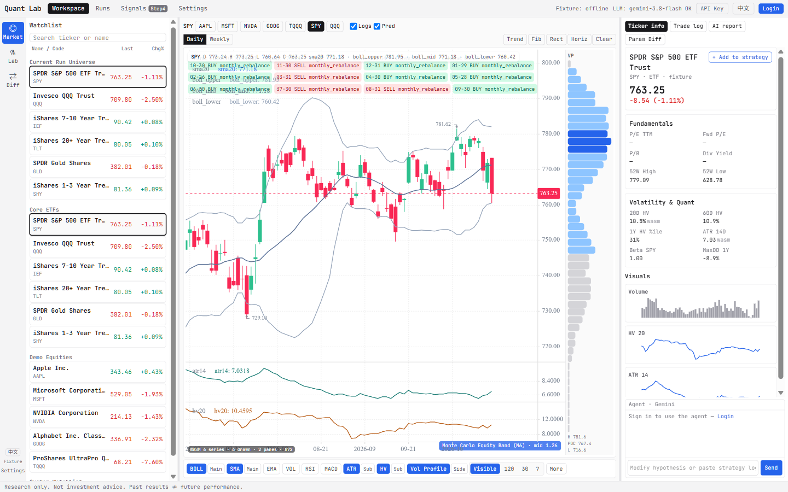
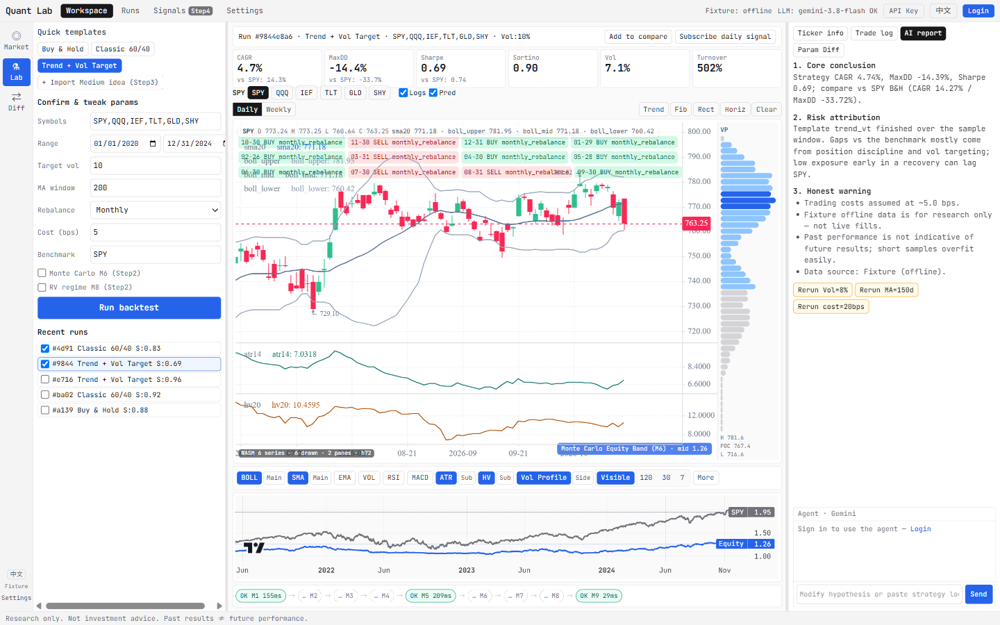
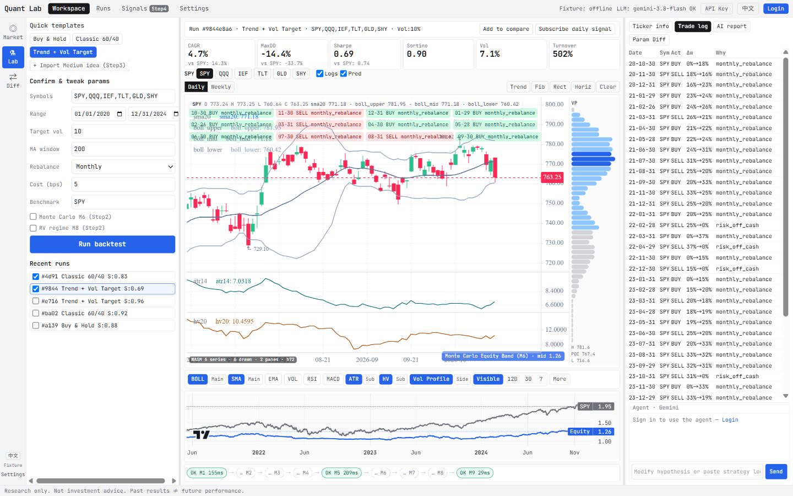
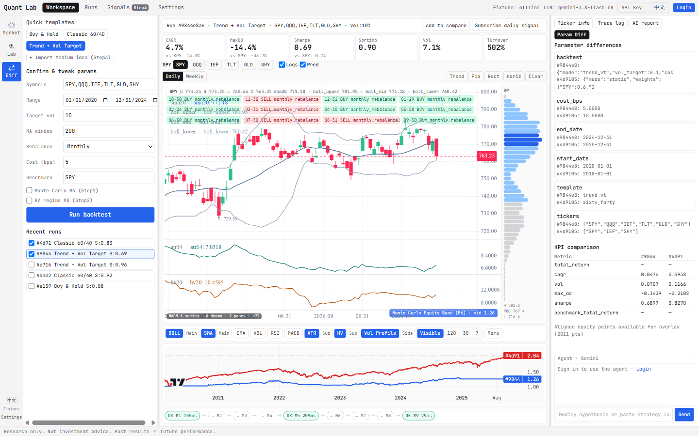

# Step 2 进度报告 · 看盘 + 策略一体工作台

**分支**：`phrase2`  
**规格**：[`docs/step2-market-workspace-spec.md`](../step2-market-workspace-spec.md)  
**状态**：**Phase 2.1 基本完成；Phase 2.2 / 2.3 主链路已通、体验与渲染仍有缺口**  
**日期**：2026-11-11

---

## 1. 目标回顾

在 Step 1 三栏工作台之上，用左侧 **Activity Bar** 把「看盘摸底」与「策略回测复盘」合到同一 `/workspace`：

| 焦点 | 用户要做的事 |
| --- | --- |
| 看盘 | Watchlist → K 线 / 指标 / 画线 → 右栏标的画像（PE、HV、ATR…） |
| 实验室 | 模板 / 参数 / Run → KPI、净值 vs SPY、AI 解读（Step 1 不退化） |
| 对比 | 多 Run 参数 Diff + KPI + 净值叠加 |

分阶段（规格 §5）：**2.1** Activity + 看盘画线 · **2.2** Trade Log 联动 + 预测图层 + M6/M8 · **2.3** Diff 闭环与测试。

---

## 2. 总体进度（对照 DoD）

| DoD（规格 §6） | 状态 | 说明 |
| --- | --- | --- |
| 看盘与参数摸底 | **基本达成** | Activity Bar ↔ Watchlist；日/周 K；WASM 指标；右栏 Overview |
| 自由画线并持久化 | **基本达成** | Trend / Fib / Rect / Horiz；`GET/PUT /market/drawings/{symbol}` |
| 图上看预测与 Log | **部分达成** | Logs/Pred 开关、标记可点进右栏；预测多为 badge/摘要级，非完整锥形 Overlay |
| 实验室不退化 | **达成** | Lab 仍可模板 → 回测 → KPI / 基准 / M9；与 Market 共用 `ChartWorkspace` |

**一句话**：看盘主链路可演示；量化叠加层与 Diff 有契约和 UI，但图上「讲故事」的完成度低于规格愿景。

---

## 3. 按 Phase 的完成情况

### 3.1 Phase 2.1 — Activity Bar + 看盘 / 画线（主链路）

| 项 | 状态 | 落点 |
| --- | --- | --- |
| Activity Bar（Market / Lab / Diff） | 完成 | `ActivityBar.tsx` + `WorkspacePage` |
| Watchlist：搜索、分组、Last / Chg% | 完成 | `WatchlistPanel` + `/market/watchlist`、`/market/search`；overview 批量补价 |
| KlineCharts 日 K | 完成 | `KlineChartCanvas`（`klinecharts`） |
| 周 K | 完成 | 前端 `resampleBarsToWeekly`（ISO 周），再跑 WASM |
| 画线工具 + 持久化 | 完成 | `DrawingToolbar`；`/market/drawings/{symbol}` |
| 右栏标的画像 | 完成 | `TickerInfoPanel`：基本面、HV/ATR/Beta、迷你 Volume/HV/ATR |
| Live / Fixture 数据源 | 完成 | `/ready` 指示；bars/overview 支持 fixture 降级 |
| 可复用图表壳 | 完成 | `ChartWorkspace`（Market + Lab 共用）；见 [`chart-workspace.md`](../chart-workspace.md) |

### 3.2 看盘指标（规格外增强，已并入主路径）

规格原写「BOLL / MA + VOL 副图」；当前远超该范围：

| 项 | 状态 | 落点 |
| --- | --- | --- |
| WASM 指标引擎 | 完成 | wickra-wasm + `quant-wasm`；见 [`wasm-indicator-engine.md`](../wasm-indicator-engine.md) |
| 主 / 副 placement | 完成 | 指标旁「主/副」；`applyPlacementToResult` |
| Volume Profile | 完成 | 侧栏默认；可切「副」底栏；窗口 **Visible / 120 / 30 / 7**（会话态） |
| 副图高度自适应 | 完成 | 按 host 高度分配 pane，避免 overflow 裁切空图 |
| Y 轴 flex → fixed | 完成 | klinecharts：默认 autoCalc；拖 Y 轴固定；双击恢复 |

### 3.3 Phase 2.2 — Trade Log + 预测图层 + M6/M8

| 项 | 状态 | 说明 |
| --- | --- | --- |
| Trade Log 上图 | **部分** | 图上气泡按钮；点击 → 右栏 Trade log Tab；**缺**：严格按时间轴对齐 K 线、图↔表双向滚动高亮 |
| Logs / Pred 开关 | 完成 | 中栏顶栏 checkbox |
| `PredictionOverlay` 契约 | 完成 | `packages/contracts` + API overlays registry |
| 图上 band / line / regime 渲染 | **弱** | 多为图例/角标级；**未**做成完整右侧延伸锥形 / regime 底色 |
| M6 / M8 真跑 | **条件达成** | Lab 开关打开时 pipeline 可跑 MC / RV；`steps_trace` 反映 completed；overlays 有 `M6McProvider` 等；默认关则为 placeholder |
| 前端轻量 MC 通道 | 完成 | WASM `wasm_mc`（≠ 后端 M6 权威摘要） |

### 3.4 Phase 2.3 — Diff + 测试

| 项 | 状态 | 说明 |
| --- | --- | --- |
| `/runs/compare` | 完成 | 参数 diff、KPI、对齐净值 |
| Diff Activity + 右栏 Diff Tab | 完成 | `RunDiffPanel`；中栏可叠对比 equity |
| 契约测试 | 部分 | `apps/api/tests/test_market_overlays.py` 覆盖 market / drawings / compare |
| 前端 Vitest | 部分 | ActivityBar、IndicatorToolbar、vpWindow、resample、placement 等；Kline 画布多为 mock |

---

## 4. 关键代码地图

| 区域 | 路径 |
| --- | --- |
| 工作台页 | `apps/web/src/workspace/WorkspacePage.tsx` |
| 图表壳 | `apps/web/src/workspace/components/ChartWorkspace.tsx` |
| K 线 / VP / 画线 | `KlineChartCanvas.tsx`、`VolumeProfilePane.tsx`、`DrawingToolbar.tsx` |
| 指标栏 | `IndicatorToolbar.tsx`；`lib/indicatorPlacement.ts`、`lib/vpWindow.ts`、`lib/resampleBars.ts` |
| WASM | `apps/web/src/wasm/*`；`crates/quant-wasm` |
| Market API | `apps/api/src/quant_lab_api/routes/market.py` |
| Overlays | `apps/api/.../services/overlays/` |
| OpenAPI / 契约 | `packages/contracts/` |

---

## 5. 当前状况（怎么用 / 卡在哪）

### 5.1 已可稳定演示

1. `/workspace` → **Market**：选 SPY/AAPL… → 日/周 K、BOLL/SMA/ATR/HV/VP、画线刷新仍在。  
2. 打开 VOL/RSI/MACD 等 → 副图有线；VP 可选 Visible 或最近 120/30/7 根。  
3. 右栏 **Ticker info**：名称、PE、波动率、迷你图。  
4. 切 **Lab**：跑模板回测 → KPI / 净值 / Pipeline；可选开 M6/M8。  
5. 勾选 ≥2 Runs → **Diff**：参数与 KPI 对比。

### 5.2 已知缺口 / 体验问题

1. **预测图层**：契约在，图上未达到规格的 band/line/regime 完整渲染。  
2. **Trade Log 联动**：有点击切 Tab，缺精确十字定位与表格↔图双向高亮。  
3. **指标过多时**：副图被压到很矮（自适应保底）；需用户自己关指标。  
4. **VP「副」模式**：底栏直方图按价位 bin，与时间轴副图语义不同，偏实验布局。  
5. **周周期**：仅前端重采样；后端 bars 仍以日频为主。  
6. **画线**：依赖登录/游客会话隔离；跨设备不共享。

### 5.3 与规格的偏差（有意或演进）

| 规格原文 | 现状 |
| --- | --- |
| 画线在「左侧窄条」 | 工具在图表顶栏右侧（`DrawingToolbar`） |
| 指标以 BOLL/MA/VOL 为主 | 完整 WASM 目录 + More + placement |
| 1D / 1W / **1M** | 仅 1D / 1W |
| Custom Watchlist 增删排序 | 分组与搜索为主；重度编辑 UX 仍薄 |

---

## 6. 关键决策（Step 2 期间）

| 决策 | 选择 |
| --- | --- |
| 图表库 | `klinecharts`（非 TradingView 嵌入） |
| 指标计算 | 浏览器 WASM（wickra + quant-wasm），不回传到 API |
| 周 K | 客户端 resample，避免双端周期分叉 |
| VP 窗口 | 默认 Visible；固定 120/30/7；无自定义 N；会话不持久化 |
| Market/Lab 图表 | 同一 `ChartWorkspace`，features 可裁剪 |
| M6 权威性 | 后端 pipeline MC；WASM MC 仅图上轻量通道 |

---

## 7. 建议下一步（按优先级）

1. **补强 Phase 2.2 渲染**：`PredictionOverlay` → 主图真实 band/line/regime；Trade Log 时间轴对齐 + 双向高亮。  
2. **验收扫一遍 DoD**：看盘摸底、画线刷新、Lab 不退化、开 M6/M8 时 overlays 可见。  
3. **Diff 体验**：对比 equity 与当前标的 K 线关系写清；空态/少于 2 Run 引导。  
4. **文档**：规格 §5 勾选可继续与本报告同步；`03` 已标历史快照，当前以本报告 + PRD 为准。

---

## 8. 界面截图（2026-11-11）

原图目录：[`docs/screenshots/step2/`](../screenshots/step2/)（说明见同目录 [README](../screenshots/step2/README.md)）。

Guest session `docs-screenshots`；实跑 Runs：`9844e8a6`（Trend + Vol Target）、`4d91055e`（Classic 60/40）。图表含 BUY/SELL markers。

### Market

Watchlist · K 线 / 指标 / VP · 当前 Run 买卖点叠加 · 右栏 Ticker info。

### Lab（回测完成）

模板与参数 · M6/M8 · 实跑 KPI · 共用图表买卖点 · AI report。

### Lab · Trade log

Trade log 表：monthly_rebalance BUY / SELL 行。

### Diff（两 Run 对比）

`9844` vs `4d91` 勾选对比 · Param Diff 有内容。

---

## 9. 相关文档

- [Step2 规格](../step2-market-workspace-spec.md)  
- [Step1 进度](./04-step1-workspace-progress.md)  
- [ChartWorkspace](../chart-workspace.md)  
- [WASM 指标引擎](../wasm-indicator-engine.md)  
- [Docs 索引](../README.md)  
